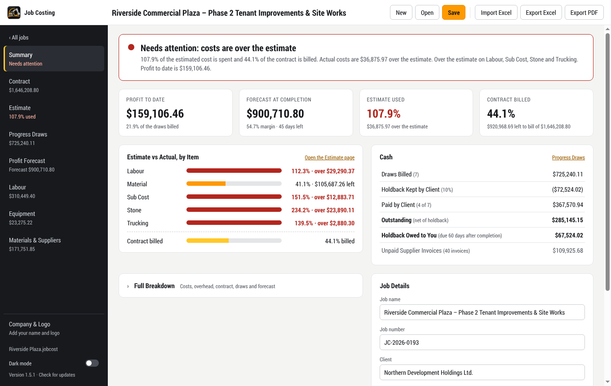
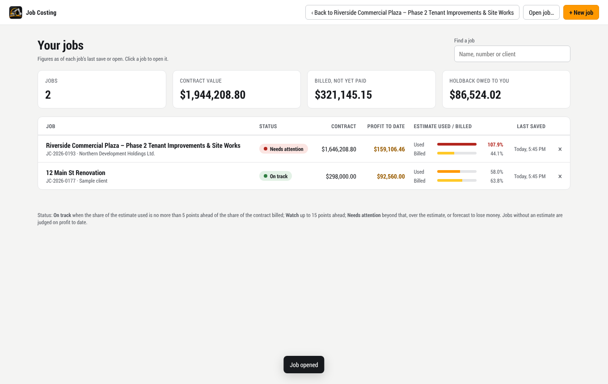
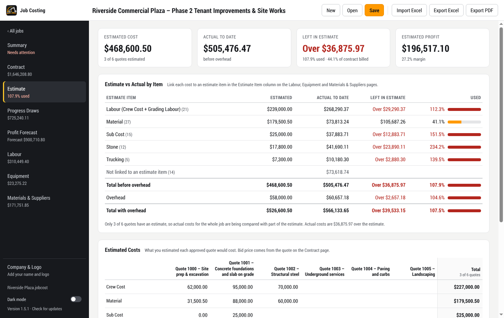

# Job Costing

[](https://github.com/JPDC17/costing/actions/workflows/release.yml)
[](https://github.com/JPDC17/costing/releases/latest)

A Windows desktop app for tracking the costs, billing and profit of construction jobs.
It follows the layout of the Basic Tracker spreadsheet
([`templates/Basic_Tracker_Template.xlsx`](templates/Basic_Tracker_Template.xlsx)). It
exports to Excel with working formulas and produces a printable PDF cost report.



## Features

- **All your jobs at a glance**: the start screen lists every job you've opened or saved
  with its status (on track, watch, needs attention), contract value, profit to date and
  how much of the estimate is used against how much is billed.
- **Job health**: each job's Summary opens with a one-line verdict, the headline
  figures, estimate-vs-actual bars and a cash panel.
- **Cost tracking**: labour, equipment, and material and supplier invoices, with a
  configurable overhead percentage (12% by default).
- **Estimated costs**: enter your estimate for each approved quote (crew, material, sub,
  grading labour, stone, trucking, overhead) and see estimated profit. Link each cost line
  to an estimate item to compare estimate against actual, item by item.
- **Contract and billing**: approved quotes and change orders, progress draws, and
  profit to date based on what has actually been billed.
- **Paid tracking and holdback**: tick boxes show which draws the client has paid and
  which supplier invoices you've paid. Holdback (10% by default) is kept back from each
  draw, so paid and outstanding are net of it, and the app tracks what's still owed to you.
- **Profit forecast**: projects labour and equipment costs to completion from the days
  worked and the days remaining.
- **Excel import and export**: the workbook uses the template's layout and live formulas,
  so it still works as a tracker in Excel.
- **PDF report**: a traditional cost report with your company letterhead and logo.
- **Company branding**: your company name, details and logo appear in the app, the PDF
  report and the Excel export.
- **Filters and compact rows**: find lines in long tables by any text, amount, estimate
  item, "not linked", "paid" or "unpaid".
- **Auto-save**: while a job has unsaved changes, a recovery copy is kept every minute
  and offered on the start screen if the app closes unexpectedly.
- **Dark mode**: switch at the bottom of the sidebar (or **View → Dark Mode**). The PDF
  report always prints black on white.
- **In-app updates**: the app finds, downloads, verifies and installs new versions itself.





## Download

Get the latest version from the
[Releases page](https://github.com/JPDC17/costing/releases/latest). There are two versions:

| | |
| --- | --- |
| [**JobCosting-Setup.exe**](https://github.com/JPDC17/costing/releases/latest/download/JobCosting-Setup.exe) (recommended) | Installs for your Windows user only (no admin rights needed), adds Start menu and desktop shortcuts, and opens in under a second. |
| [**JobCosting-Portable.exe**](https://github.com/JPDC17/costing/releases/latest/download/JobCosting-Portable.exe) | A single file you can run from anywhere, e.g. a USB stick. Nothing is installed, but it takes several seconds to open because it unpacks itself each time. |

Both update themselves from inside the app, and both use the same job files and settings.

> [!NOTE]
> The exe isn't code-signed, so the first time you run it Windows SmartScreen may warn
> about an unknown publisher. Click **More info → Run anyway**.

## Usage

| Section | What goes in it |
| --- | --- |
| All jobs | Every job you've opened or saved, with its status and figures |
| Summary | Job health, headline figures, estimate vs actual, cash, job details |
| Contract | Approved quotes (the contract value) and change orders |
| Estimate | Estimated costs for each approved quote, and estimate vs actual by item |
| Progress Draws | Each draw submitted (date, amount, paid) and holdback |
| Profit Forecast | Days worked, days remaining, materials still to buy |
| Labour / Equipment | Dated cost entries, each linked to an estimate item if you like |
| Materials & Suppliers | Supplier invoices, with totals per company, a Paid tick box and an estimate item |
| Company & Logo | Your company name, contact details and logo |

Jobs are saved as `.jobcost` files.

| Shortcut | Action |
| --- | --- |
| Ctrl+S / Ctrl+Shift+S | Save / Save As |
| Ctrl+O | Open |
| Ctrl+Shift+J | All jobs (start screen) |
| Ctrl+E / Ctrl+I | Export to Excel / Import from Excel |
| Ctrl+P | Export PDF report |
| Enter, arrow keys | Move between rows and add new ones, as in a spreadsheet |

Import Excel accepts a filled-in copy of the Basic Tracker template or a workbook
exported by the app.

## How the numbers are calculated

The Summary matches the template's **Total Breakdown** sheet:

```
Total             = Labour + Equipment + Material and Supplier
Overhead          = Total × overhead %
Total Costs       = Total + Overhead
Total Contract    = Approved quotes (change orders are tracked separately, as in the template)
Contract Profit   = Total Contract − Total Costs
```

Progress draws:

```
Billed to Date    = Draws Submitted ÷ Total Contract
Remaining to Bill = Total Contract − Draws Submitted
Profit to Date    = Draws Submitted − Total Costs
Holdback (draw)   = Draw × holdback %          (rounded to the cent, per draw)
Paid by Client    = paid draws, less their holdback
Outstanding       = unpaid draws, less their holdback
Holdback Owed     = holdback on all draws − holdback received
```

Job status (start screen and Summary), with an estimate: **On track** when the share of
the estimate used is no more than 5 points ahead of the share of the contract billed,
**Watch** up to 15 points ahead, **Needs attention** beyond that, over the estimate, or
forecast to lose money. Without an estimate it's judged on profit to date.

The forecast:

```
Remaining Labour     = Labour to date × Days Remaining ÷ Days Worked   (same for equipment)
Forecast Total Costs = Costs to date + remaining labour + remaining equipment
                       + materials still to buy, plus overhead
Forecast Profit      = Total Contract − Forecast Total Costs
```

Estimated costs, for each approved quote:

```
Total Cost        = Crew Cost + Material + Sub Cost + Grading Labour + Stone + Trucking
Profit            = Bid Price (the quote's total) − Total Cost − Overhead
Estimate Used     = actual costs before overhead ÷ estimated Total Cost
```

Only quotes with an estimate are counted in the estimate totals.

Each labour, equipment and invoice line can be linked to an estimate item (Labour,
Material, Sub Cost, Stone or Trucking) in its **Estimate Item** column. Labour is compared
with the estimate's Crew Cost + Grading Labour.
The app then compares each item's estimate with the actual costs linked to it:

```
Actual (item)     = sum of the cost lines linked to that item
Left in Estimate  = Estimated − Actual         (shown as "Over" when negative)
Not linked        = costs not linked to any item, so the totals still add up
```

Amounts are rounded to the cent the same way Excel's `ROUND` does, so the app and the
exported workbook always agree. Paid status is for cash tracking only: profit counts
every draw billed and every invoice received.

## Building from source

Requires [Node.js](https://nodejs.org) 22 or later.

```bash
git clone https://github.com/JPDC17/costing.git
cd costing
npm install
npm start          # run the app
npm test           # run the unit tests
npm run dist:win   # build dist/JobCosting-Portable.exe and dist/JobCosting-Setup.exe
```

`npm run dist:mac` and `npm run dist:linux` build for macOS and Linux.

Before packaging, the build step (`scripts/bundle.js`) compiles the main process and its
libraries into a single minified file. This keeps the exe small.

### Project structure

```
src/
  main.js        Electron main process: window, menus, files, updates
  preload.js     Bridge between the window and the main process
  calc.js        Costing calculations (shared by the app, exports and tests)
  excel.js       Excel import and export
  company.js     Company details and logo settings
  updater.js     Update manifest checks, the portable exe swap and the installer update
  renderer/      User interface (HTML, CSS, JS, fonts, logo)
scripts/         Build, release and Windows test scripts
test/            Unit tests
templates/       The original Basic Tracker template
build/           App icon
```

## Releasing

Releases are built and published by GitHub Actions
([`.github/workflows/release.yml`](.github/workflows/release.yml)).

1. Raise `version` in `package.json`.
2. Describe the change in `RELEASE_NOTES.md`. The app shows this text in its update prompt.
3. Commit and push.

Every push runs the unit tests and two end-to-end update tests on Windows: a real
portable exe updates itself to a newer build, and a real installed copy (installed
silently with the installer) updates itself with the newer installer. If the version
hasn't been released yet, the workflow then builds both and publishes a GitHub Release
`v<version>` with `JobCosting-Setup.exe`, `JobCosting-Portable.exe` and `latest.json`.
Copies of the app read that `latest.json` and offer the update.

## License

All rights reserved. The bundled Roboto Condensed font is licensed under the
[Apache License 2.0](src/renderer/fonts/LICENSE-2.0.txt).
