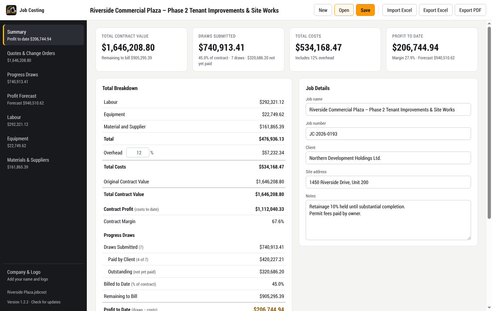
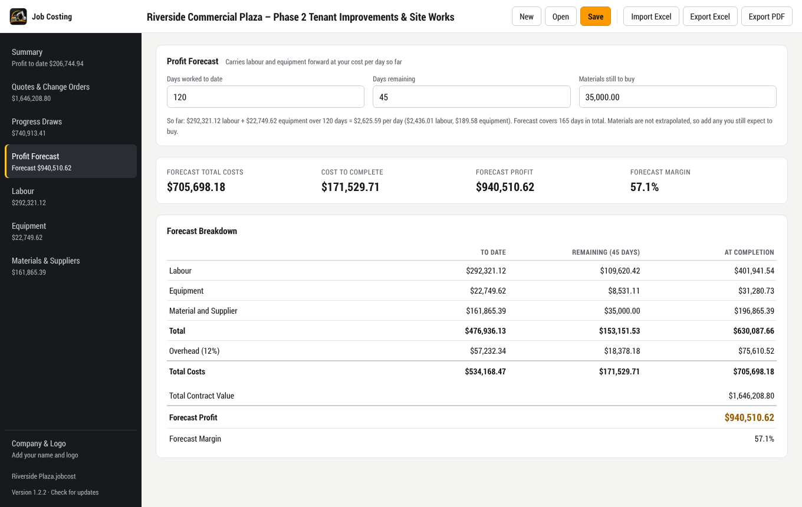

# Job Costing

[](https://github.com/JPDC17/costing/actions/workflows/release.yml)
[](https://github.com/JPDC17/costing/releases/latest)

A Windows desktop app for tracking the costs, billing and profit of construction jobs.
It follows the layout of the Basic Tracker spreadsheet
([`templates/Basic_Tracker_Template.xlsx`](templates/Basic_Tracker_Template.xlsx)). It
exports to Excel with working formulas and produces a printable PDF cost report.



## Features

- **Cost tracking**: labour, equipment, and material and supplier invoices, with a
  configurable overhead percentage (12% by default).
- **Contract and billing**: approved quotes and change orders, progress draws, and
  profit to date based on what has actually been billed.
- **Paid tracking**: tick boxes show which draws the client has paid and which supplier
  invoices you've paid.
- **Profit forecast**: projects labour and equipment costs to completion from the days
  worked and the days remaining.
- **Excel import and export**: the workbook uses the template's layout and live formulas,
  so it still works as a tracker in Excel.
- **PDF report**: a traditional cost report with your company letterhead and logo.
- **Company branding**: your company name, details and logo appear in the app, the PDF
  report and the Excel export.
- **In-app updates**: the app finds, downloads, verifies and installs new versions itself.



## Download

Get the latest version from the
[Releases page](https://github.com/JPDC17/costing/releases/latest) or
[download the exe directly](https://github.com/JPDC17/costing/releases/latest/download/JobCosting-Portable.exe).

`JobCosting-Portable.exe` is a single portable file, so there's nothing to install.
Save it anywhere and double-click it.

> [!NOTE]
> The exe isn't code-signed, so the first time you run it Windows SmartScreen may warn
> about an unknown publisher. Click **More info → Run anyway**.

## Usage

| Section | What goes in it |
| --- | --- |
| Summary | Live totals, job details, profit to date and the forecast |
| Quotes & Change Orders | Approved quotes (the contract value) and change orders |
| Progress Draws | Each draw submitted: date, amount, and whether it's been paid |
| Profit Forecast | Days worked, days remaining, materials still to buy |
| Labour / Equipment | Dated cost entries |
| Materials & Suppliers | Supplier invoices, with totals per company and a Paid tick box |
| Company & Logo | Your company name, contact details and logo |

Jobs are saved as `.jobcost` files.

| Shortcut | Action |
| --- | --- |
| Ctrl+S / Ctrl+Shift+S | Save / Save As |
| Ctrl+O | Open |
| Ctrl+E / Ctrl+I | Export to Excel / Import from Excel |
| Ctrl+P | Export PDF report |
| Enter, arrow keys | Move between rows and add new ones, as in a spreadsheet |

Import Excel accepts a filled-in copy of the Basic Tracker template or a workbook
exported by the app.

## How the numbers are calculated

The Summary matches the template's **Total Breakdown** sheet:

```
Total             = Labour + Equipment + Material and Supplier
Overhead          = Total × overhead %
Total Costs       = Total + Overhead
Total Contract    = Approved quotes (change orders are tracked separately, as in the template)
Contract Profit   = Total Contract − Total Costs
```

Progress draws:

```
Billed to Date    = Draws Submitted ÷ Total Contract
Remaining to Bill = Total Contract − Draws Submitted
Profit to Date    = Draws Submitted − Total Costs
Outstanding       = Draws Submitted − draws marked Paid
```

The forecast:

```
Remaining Labour     = Labour to date × Days Remaining ÷ Days Worked   (same for equipment)
Forecast Total Costs = Costs to date + remaining labour + remaining equipment
                       + materials still to buy, plus overhead
Forecast Profit      = Total Contract − Forecast Total Costs
```

Amounts are rounded to the cent the same way Excel's `ROUND` does, so the app and the
exported workbook always agree. Paid status is for cash tracking only: profit counts
every draw billed and every invoice received.

## Building from source

Requires [Node.js](https://nodejs.org) 22 or later.

```bash
git clone https://github.com/JPDC17/costing.git
cd costing
npm install
npm start          # run the app
npm test           # run the unit tests
npm run dist:win   # build dist/JobCosting-Portable.exe
```

`npm run dist:mac` and `npm run dist:linux` build for macOS and Linux.

Before packaging, the build step (`scripts/bundle.js`) compiles the main process and its
libraries into a single minified file. This keeps the exe small.

### Project structure

```
src/
  main.js        Electron main process: window, menus, files, updates
  preload.js     Bridge between the window and the main process
  calc.js        Costing calculations (shared by the app, exports and tests)
  excel.js       Excel import and export
  company.js     Company details and logo settings
  updater.js     Update manifest checks and the Windows exe swap
  renderer/      User interface (HTML, CSS, JS, fonts, logo)
scripts/         Build, release and Windows test scripts
test/            Unit tests
templates/       The original Basic Tracker template
build/           App icon
```

## Releasing

Releases are built and published by GitHub Actions
([`.github/workflows/release.yml`](.github/workflows/release.yml)).

1. Raise `version` in `package.json`.
2. Describe the change in `RELEASE_NOTES.md`. The app shows this text in its update prompt.
3. Commit and push.

Every push runs the unit tests and an end-to-end update test on Windows, in which a real
packaged exe updates itself to a newer build. If the version hasn't been released yet,
the workflow then builds the exe and publishes a GitHub Release `v<version>` with
`JobCosting-Portable.exe` and `latest.json`. Installed copies of the app read that
`latest.json` and offer the update.

## License

All rights reserved. The bundled Roboto Condensed font is licensed under the
[Apache License 2.0](src/renderer/fonts/LICENSE-2.0.txt).
